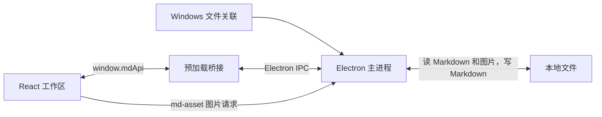

# Markdown Viewer 项目蓝图

## System Overview

Markdown Viewer 是用 Electron、React 和 TypeScript 构建的桌面应用。它可以打开本地 `.md` 和 `.markdown` 文件，在同一工作区的标签页中阅读、搜索、编辑和保存。预览支持 GFM 表格、任务列表、脚注、代码高亮、KaTeX 公式、Mermaid 图表及本地相对路径图片。示例覆盖了正文、大纲、同名标题、公式与图片。 [示例文档](./samples/demo.md) · [应用依赖](./package.json)



### 快速开始

开发环境使用 Node.js 24 和 pnpm 10。在项目根目录安装锁定依赖并启动开发模式。首次运行 `pnpm dev` 或 `pnpm preview` 时可能需要下载 Electron 运行时。 [项目脚本](./package.json) · [锁定依赖](./pnpm-lock.yaml) · [打包说明](./PACKAGING.md)

```sh
pnpm install --frozen-lockfile
pnpm dev
```

打开一个文件后，可以继续从工具栏、最近打开列表或拖放入口打开其他文档。点击「源码」可编辑文档，点击「分栏」可在左侧预览、右侧编辑。修改后用工具栏的保存按钮写回原文件。Windows 中，可将 `.md` 的默认打开方式设为当前绿色版的 `Markdown Viewer.exe`。应用未运行时，双击文件会启动工作区。后续双击在当前窗口打开标签，重复打开同一路径会切到原标签。 [打开与保存逻辑](./src/renderer/src/App.tsx) · [Windows 启动逻辑](./src/main/index.ts) · [绿色版说明](./PACKAGING.md#windows-绿色版)

| 操作 | 快捷键 |
| --- | --- |
| 打开文件 | `Ctrl/⌘ + O` |
| 保存、刷新当前文档 | `Ctrl/⌘ + S`、`Ctrl/⌘ + R` |
| 查找、关闭当前标签 | `Ctrl/⌘ + F`、`Ctrl/⌘ + W` |
| 下一个、上一个标签 | `Ctrl/⌘ + Tab`、`Ctrl/⌘ + Shift + Tab` |
| 切换大纲 | `Ctrl/⌘ + Shift + O` |

快捷键在原生菜单或工作区定义。 [createApplicationMenu](./src/main/index.ts) · [工作区键盘处理](./src/renderer/src/App.tsx)

## Local Interface & Invariants

| 文件 | 维护约定 |
| --- | --- |
| [package.json](./package.json) | 定义应用版本、开发与打包脚本、目标系统和应用包文件清单。打包入口为 `out/main/index.js`。 |
| [electron.vite.config.ts](./electron.vite.config.ts) | 构建主进程、预加载和渲染端。预加载打包为 CommonJS，关闭依赖外置。渲染入口使用根目录的 `index.html`。 |
| [index.html](./index.html) | 声明工作区的内容安全策略，提供 React 挂载节点并加载渲染入口。 |
| [build/update-portable.cjs](./build/update-portable.cjs) | 处理 `portable` 产物完成事件。在 `release/` 内先写临时副本，再替换固定名称的单文件便携包。 |
| [pnpm-workspace.yaml](./pnpm-workspace.yaml) | 声明 pnpm 工作区、构建脚本许可及定向依赖覆盖。 |

## Subdirectories & System Boundaries

- [源码索引](./src/README.md) 汇总主进程、预加载、渲染工作区及共享类型的边界。
- [主进程](./src/main/README.md) 记录窗口生命周期、文件读写、系统 Shell 和本地图片处理。
- [预加载桥接](./src/preload/README.md) 记录 `window.mdApi`、事件订阅和图片 URL 转换。
- [渲染工作区](./src/renderer/src/README.md) 记录标签状态、草稿、模式切换、搜索与目录跟随。
- [打包说明](./PACKAGING.md) 记录各平台目标、Windows 绿色版与单文件便携版。 [更新日志](./CHANGELOG.md) 记录版本变化。

## Global Invariants

- 工作区启用上下文隔离和 Electron 沙箱，关闭渲染端的 Node 集成。文件读写经预加载桥接到主进程，并校验 Markdown 扩展名。涉及桥接变更时，同步核对主进程通道、预加载实现和渲染端类型。 [窗口配置](./src/main/index.ts) · [桥接实现](./src/preload/index.ts) · [MdApi 类型](./src/renderer/src/types/global.d.ts)
- 工作区收到 Electron 首次绘制事件和渲染端首屏就绪通知后才显示。Windows 打包版通过单实例锁复用工作区，首屏期间收到的外部文件请求按顺序交付。 [主进程窗口生命周期](./src/main/README.md) · [渲染端启动逻辑](./src/renderer/src/README.md)
- 标签使用主进程返回的文件路径作为 ID。每个标签分别保存原始内容和草稿。正常打开同一路径时保留已有草稿，保存和确认后的刷新才使用重读内容替换。 [标签与草稿契约](./src/renderer/src/README.md)
- 正文预览和目录共用解析得到的 Markdown 树与标题 ID。HTML 清理配置和内容安全策略分别约束预览输出与资源加载，预览与源码之间用源码位置恢复阅读进度。 [Markdown 渲染](./src/renderer/src/components/MarkdownViewer.tsx) · [渲染工具](./src/renderer/src/utils/README.md) · [内容安全策略](./index.html)

## Global Side Effects

- 保存写入选中的本地 Markdown 文件。最近打开路径、主题和大纲展开偏好进入配置中的 `localStorage`，当前标签与未保存草稿保存在工作区内存。 [文件读写](./src/main/README.md) · [渲染端状态](./src/renderer/src/README.md)
- Windows 打包版默认使用 Electron `userData` 目录下的 `windows-profile`，与使用默认目录的旧版配置隔离。采用同一配置目录的新版构建可以复用工作区。更新绿色包前先退出旧工作区，以便下次打开运行新构建。 [startApplication](./src/main/index.ts) · [绿色版更新](./PACKAGING.md#windows-绿色版)
- 相对路径图片由主进程读取，正文也允许加载 HTTP/HTTPS 图片。外部链接可以经系统默认应用打开，复制代码会使用剪贴板。 [资源与链接实现](./src/renderer/src/components/README.md) · [资源策略](./index.html)
- `pnpm build` 生成 `out/`，各平台打包命令默认写入 `release/<版本>/`。 [构建脚本与输出配置](./package.json) · [打包说明](./PACKAGING.md)

## System Verification

在项目根目录执行 `pnpm build`，依次运行 TypeScript 类型检查和 Electron Vite 构建。当前 [package.json](./package.json) 的脚本包含构建与预览命令，应用运行行为需在对应桌面产物中验收。

| 场景 | 检查项 |
| --- | --- |
| 打开与渲染 | 用 [示例文档](./samples/demo.md) 检查表格、公式、Mermaid、相对路径图片及两个同名标题的跳转。 |
| 标签与保存 | 打开两份测试文档，在源码模式编辑其中一份并切换标签，确认回到原标签时草稿仍在。用测试副本检查保存和未保存关闭提示。 |
| 文末目录跳转 | 找到同一屏的两个文末标题，分别点击左侧目录，确认每次都高亮点中的标题。点击远处标题时，检查左栏位置和正文滚动。 |
| Windows 文件关联 | 将测试用 `.md` 关联到新版绿色 EXE，依次双击两个不同文件及一个已打开的文件，检查共用窗口、原标签复用与最小化恢复。 |

使用 `pnpm preview` 可启动已构建的应用。需要核对发布目录和各平台目标时，参照 [打包说明](./PACKAGING.md)。

## 许可证

项目使用 [MIT 许可证](./LICENSE)。随包依赖与声明见 [第三方许可证清单](./THIRD_PARTY_LICENSES.md) 和 [第三方声明](./THIRD_PARTY_NOTICES.md)。
