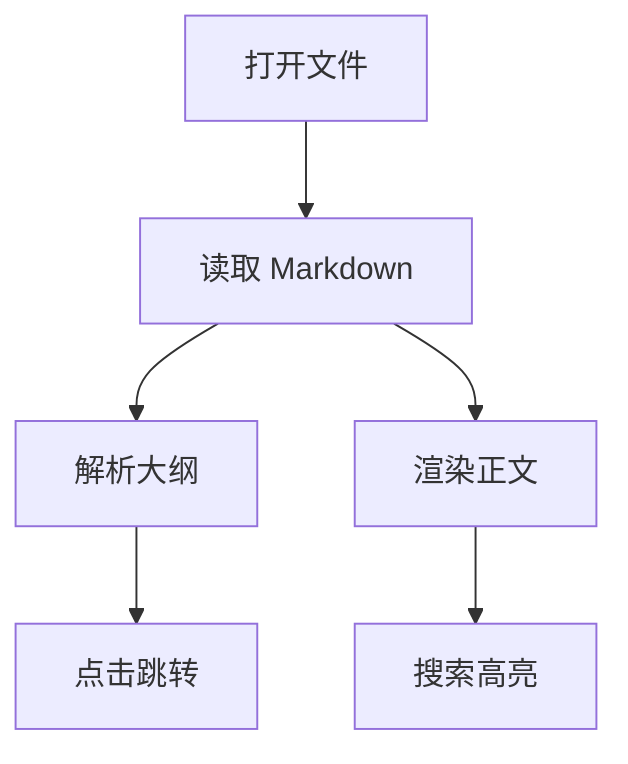

# Markdown Viewer Demo

这是一份用于验收本地 Markdown 查看器的示例文档，覆盖标题、大纲、搜索、图片、代码、数学公式和安全 HTML。


## 基础格式

普通段落支持 **加粗**、*斜体*、~~删除线~~、`inline code` 和 [外部链接](https://example.com)。

> 这是一段引用内容，用于验证 blockquote 的左边框和排版。

---

### 无序列表

- 项目 A
- 项目 B
  - 嵌套项目 B.1
  - 嵌套项目 B.2
- 项目 C

### 有序列表

1. 第一步
2. 第二步
3. 第三步

## 安装

这是第一个重复标题，用于验证 slug 生成。

## 安装

这是第二个重复标题，正文标题 id 应该与左侧大纲保持一致。

## GFM 表格

| 功能 | 状态 | 说明 |
| --- | --- | --- |
| 表格 | 完成 | 支持边框和横向滚动 |
| 任务列表 | 完成 | 支持勾选状态 |
| 脚注 | 完成 | 使用 remark-gfm |

## 任务列表

- [x] 打开 Markdown 文件
- [x] 渲染本地图片
- [ ] 添加编辑器功能

## 代码块

```ts
type User = {
  id: number;
  name: string;
};

const user: User = {
  id: 1,
  name: "Ada"
};

console.log(user.name);
```

```unknown-language
plain fallback code block
```

## Mermaid



## 数学公式

行内公式：$E = mc^2$。

块级公式：

$$
\int_{-\infty}^{\infty} e^{-x^2}\,dx = \sqrt{\pi}
$$

## 内嵌 HTML

<details>
  <summary>展开安全 HTML 内容</summary>
  <p>details 和 summary 应该可以正常显示，但脚本和事件属性不应执行。</p>
</details>

<script>
  alert("这段脚本不应该执行");
</script>

<p onclick="alert('不应该执行')">这段文字的 onclick 应该被 sanitize 移除。</p>

## 脚注

这里引用一个脚注。[^note]

[^note]: 这是脚注内容。

## 图片失败占位


